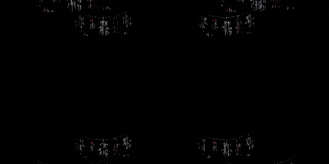
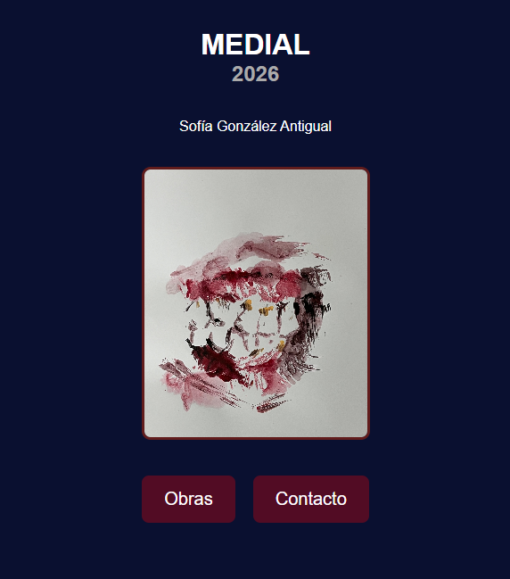
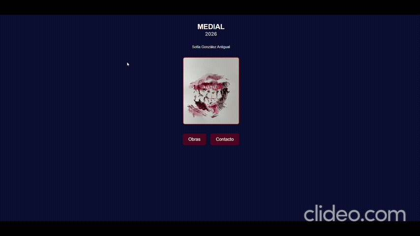
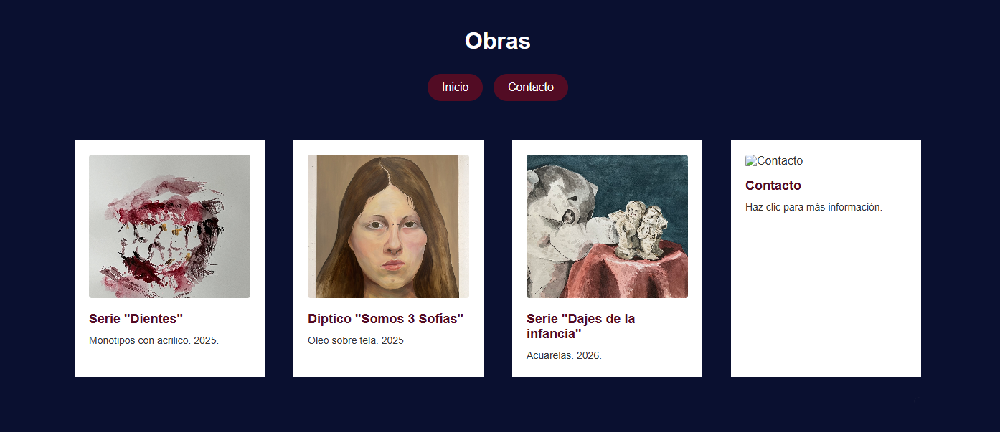
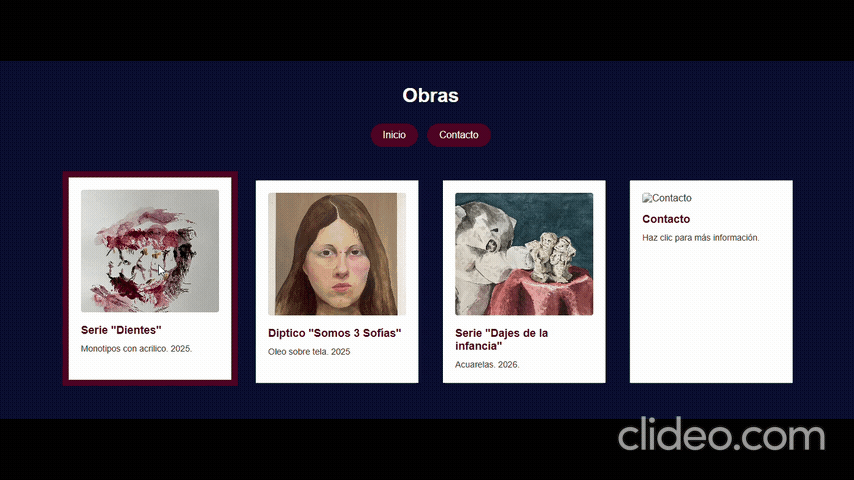
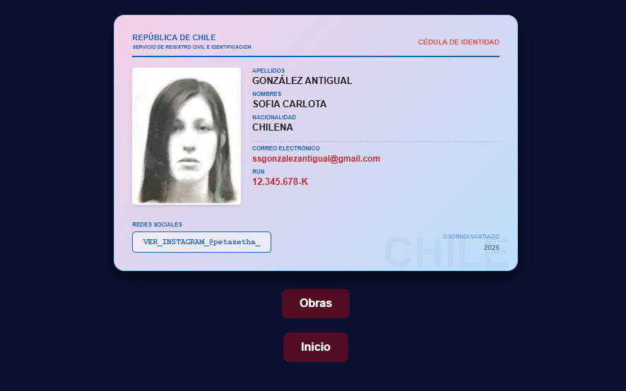
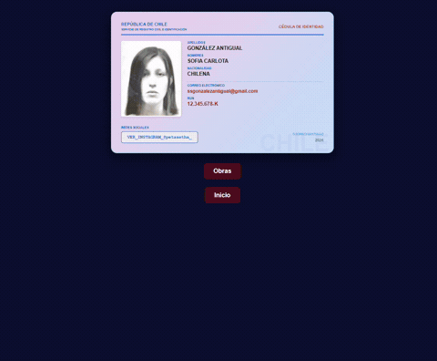
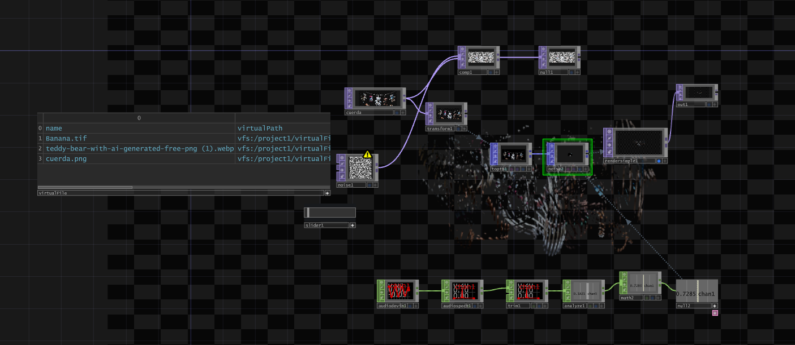

<div style="background-color: #080c2e; color: #ffffff; padding: 24px; border-radius: 10px;">

# Multimedial

<h2 style="color: pink;">Taller Multimedia</h2>



<h3 style="color: pink; margin-top: 20px;">Codigo base</h3>

```
<!DOCTYPE html>
<!-- Indica al navegador que este documento usa HTML5 -->

<html>
<!-- Inicio del documento HTML -->

<head>
<!-- Sección donde van metadatos, título y estilos -->

<meta charset="UTF-8">
<!-- Define la codificación de caracteres para que se vean bien tildes y símbolos -->

<title>Multimedial</title>
<!-- Título de la página que aparece in la pestaña del navegador -->

<style>
/* Aquí comienza la sección de estilos CSS que define la apariencia visual */

body{
/* "body" se refiere a todo el contenido visible de la página */

  background-color: white;
  /* Define que el fondo de toda la página sea blanco */

  color: black;
  /* Define que el color del texto sea negro */

  margin: 0;
  /* Elimina los márgenes que los navegadores agregan por defecto */

  height: 100vh;
  /* Hace que el alto del cuerpo sea igual al 100% de la altura de la pantalla */

  display: flex;
  /* Activa el sistema Flexbox para organizar y centrar elementos */

  justify-content: center;
  /* Centra el contenido horizontalmente */

  align-items: center;
  /* Centra el contenido verticalmente */

  font-family: Arial, sans-serif;
  /* Define la tipografía del texto */

  font-size: 60px;
  /* Define el tamaño grande del texto */

}
/* Fin de las reglas de estilo del body */

</style>
<!-- Fin de la sección de estilos -->

</head>
<!-- Fin de la sección head -->

<body>
<!-- Inicio del contenido visible de la página -->

MULTIMEDIAL
<!-- Texto que aparece en el centro de la pantalla -->

</body>
<!-- Fin del contenido visible -->

</html>
<!-- Fin del documento HTML -->

```
<h2 style="color: pink;">Unidad 1; HTML.</h2>

Resultados : (https://sofiagon2019.github.io/Multimedial/w/index.html)

Ejercicios relacionados : Mi primera pagina, Enlaces-Link, Mini sitio - 3 páginas conectadas, Css-intermedio-interacción-y-layout


Lo primero que uno ve al entrar a la pagina web es el inicio, donde hay un titulo respecto a la asignatura y el año, bajo ello, mi nombre, un trabajo como forma de presentacion y dos botones que dirigen a dos paginas enlazadas.

La base de esta primera pagina fue a aprtir del codigo que esta al inicio, el cual ayudo a estructurar el cuerpo, los enzabezados, los tamaños y colores.

La seleccion de coloresa para el fondo y las letras fue en base a los colores predominantes de mis obras. En su mayoria siempre son fondos azules profundos, en fisico siendo una mezcla entre azul prusia y un cafe van dyck, con un poco de negro. Y usualmente las telas son de un rojo que puede variar entre vino y bermellon.






El primer boton: "Obras" redirije a la primera pagina enlazada, que  nos muestra las colecciones de obras que tenia hasta el momento



Al presionar cada seccion (una nueva pagina enlazada) se puede visualizar las obras que forman parte de cada conjunto, si presionas la imagen del jumbito con la estatuilla es posible verla en gran tamaño (pantalla completa) para poder apreciar la textura de la acuarela. Ademas bajo cada titulo hay una serie de botones con acciones determinadas.




El boton de "inicio" te lleva a la primera pagina que vimos. El boton "regresar" hace que vuelvas a la pagina anterior, solo la serie "dajes de la infancia" cuenta con uno adicional llamado "Informacion" que la idea es que cada seccion pueda tener la suyacon informacion particular y el proceso de cada serie. El ultimo boton "contacto" nos redirige a la infromacion para contactarme.




Esta seccion varia entre informacion ficticia (como lo seria el rut) e informacion veridica. Cuenta con mi nombre completo, mi nacionalidad, mi correo profesional, bajo la imagen un enlace directo a mis redes sociales, y al extremo derecho las ciudades en las que me muevoi constantemente. 

El diseño esta basado en mi propio carnet y estructurado de una manera en que lo simule lo mas posible, incluso la imagen es mi foto de carnet. 




<h2 style="color: pink;">Unidad 2</h2>

1. Chroma : 
(https://drive.google.com/drive/folders/1e34pHxCat-S4MoswmgBc2NVqL5xLVb7-?usp=drive_link)
2. Comfy : 
(https://drive.google.com/drive/folders/1D_vGCYY3oZcm2EmHAGuZBf-t21Su40ca?usp=drive_link)
3. Lsystem : 
(https://drive.google.com/drive/folders/1hiXEnyceTAoUGwMRY6rGYl_LbVZshDiD?usp=drive_link)
4. Point : 
(https://drive.google.com/drive/folders/1mkIxrSvEnpcig926Nl08FHX2OpbZe7ty?usp=drive_link)

<h2 style="color: pink;">Proyecto personal</h2>


Resultados : (https://drive.google.com/drive/folders/1pxHwFiklkDJDoBmsWlR-YDcjWyTgkLDF?usp=drive_link)

Dentro del link se pueden observar 4 elementos : 

1. Desarrollo : esta incluye todo el proceso del proyecto (versiones anteriores, pruebas con otros sistemas, con otras imagenes, etc) 
2. Video : Esta incluye la grabacion de pantalla del proyecto final, que corresponde al mismo gif que se ve al inicio del README.
3. Propuesta : un documneto que habla del resumen de la obra, su concepto, montaje y materiales necesarios para este. 
4. Proyecto Final : el archivo final.



Esta es la conformacion del proyecto, la imagen de los osos colgando fue generada por Comfy a partir de mis trabajos en el ramo de pintura, donde yo trabajo con bodegones de peluche. La imagen tiene la caracteristica de que se mece en su eje, y que es interactiva respecto al ruido del lugar: mientras mas ruido, mas se distorsiona y es dificil de ver, pero si no hay ruido esta se queda junta y se puede ver como se mece. 
</div>