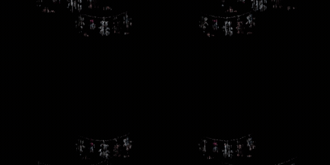

# Multimedial

<h2 style="color: pink;">Taller Multimedia</h2>




Ejercicio 1,semana 1:

```
<!DOCTYPE html>
<!-- Indica al navegador que este documento usa HTML5 -->

<html>
<!-- Inicio del documento HTML -->

<head>
<!-- Sección donde van metadatos, título y estilos -->

<meta charset="UTF-8">
<!-- Define la codificación de caracteres para que se vean bien tildes y símbolos -->

<title>Multimedial</title>
<!-- Título de la página que aparece en la pestaña del navegador -->

<style>
/* Aquí comienza la sección de estilos CSS que define la apariencia visual */

body{
/* "body" se refiere a todo el contenido visible de la página */

  background-color: white;
  /* Define que el fondo de toda la página sea blanco */

  color: black;
  /* Define que el color del texto sea negro */

  margin: 0;
  /* Elimina los márgenes que los navegadores agregan por defecto */

  height: 100vh;
  /* Hace que el alto del cuerpo sea igual al 100% de la altura de la pantalla */

  display: flex;
  /* Activa el sistema Flexbox para organizar y centrar elementos */

  justify-content: center;
  /* Centra el contenido horizontalmente */

  align-items: center;
  /* Centra el contenido verticalmente */

  font-family: Arial, sans-serif;
  /* Define la tipografía del texto */

  font-size: 60px;
  /* Define el tamaño grande del texto */

}
/* Fin de las reglas de estilo del body */

</style>
<!-- Fin de la sección de estilos -->

</head>
<!-- Fin de la sección head -->

<body>
<!-- Inicio del contenido visible de la página -->

MULTIMEDIAL
<!-- Texto que aparece en el centro de la pantalla -->

</body>
<!-- Fin del contenido visible -->

</html>
<!-- Fin del documento HTML -->

```
<h2 style="color: pink;">Unidad 1; HTML.</h2>

Resultados : (https://sofiagon2019.github.io/Multimedial/w/index.html)

Ejercicios relacionados : Mi primera pagina, Enlaces-Link, Mini sitio - 3 páginas conectadas, Css-intermedio-interacción-y-layout
<h2 style="color: pink;">Unidad 2</h2>

1. Chroma : 
(https://drive.google.com/drive/folders/1e34pHxCat-S4MoswmgBc2NVqL5xLVb7-?usp=drive_link)
2. Comfy : 
(https://drive.google.com/drive/folders/1D_vGCYY3oZcm2EmHAGuZBf-t21Su40ca?usp=drive_link)
3. Lsystem : 
(https://drive.google.com/drive/folders/1hiXEnyceTAoUGwMRY6rGYl_LbVZshDiD?usp=drive_link)
4. Point : 
(https://drive.google.com/drive/folders/1mkIxrSvEnpcig926Nl08FHX2OpbZe7ty?usp=drive_link)
5. Proyecto personal :
(https://drive.google.com/drive/folders/1pxHwFiklkDJDoBmsWlR-YDcjWyTgkLDF?usp=drive_link)